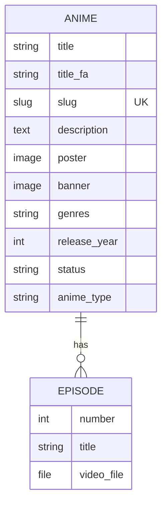
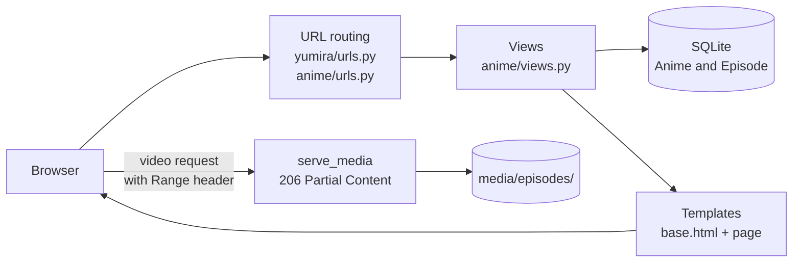

<p align="center">
  
</p>

<p align="center">
  &nbsp;&nbsp;
  &nbsp;&nbsp;
  &nbsp;&nbsp;
  &nbsp;&nbsp;
  
</p>

<p align="center">
  
  
  
</p>

# YUMIRA

YUMIRA is a Persian, right-to-left anime site built with Django. Visitors browse an archive, open the page of an anime, watch an episode in a custom video player and download it. Anime and episodes are added through the Django admin, and each episode holds one uploaded video file.

The project is a learning project. The anime in the sample data are made up, and the site is not a public streaming service.

| | |
| --- | --- |
| Slogan | Beyond Your Imagination. |
| Language | Persian (`LANGUAGE_CODE = "fa"`, `dir="rtl"`), time zone `Asia/Tehran` |
| Backend | Python and Django, SQLite |
| Frontend | Django templates, one CSS file, vanilla JavaScript |
| Dependencies | `Django` and `Pillow` |
| Player | Custom, built on the HTML5 `<video>` tag, no libraries |
| Tests | 10 Django tests |

## Contents

- [Features](#features)
- [Tech stack](#tech-stack)
- [Pages and URLs](#pages-and-urls)
- [Data model](#data-model)
- [How it works](#how-it-works)
- [The video player](#the-video-player)
- [Serving media with Range support](#serving-media-with-range-support)
- [Design](#design)
- [Getting started](#getting-started)
- [Adding anime and episodes](#adding-anime-and-episodes)
- [Configuration](#configuration)
- [Sample data](#sample-data)
- [Tests](#tests)
- [Project structure](#project-structure)
- [Limitations](#limitations)

## Features

Browsing

- Home page with a hero section, four featured anime (newest release years first) and four recently added anime.
- Archive page with a search box and a status filter. Search matches the English and the Persian title. Changing the status dropdown sends the form right away.
- A result count under the filters, and a message when nothing matches.
- Detail page with a banner, poster, original and Persian title, release year, type, status, number of episodes, genre chips, a summary and the episode list.
- Years and counts are written with Persian digits through the `fa_digits` template filter.
- Anime without a poster or banner get a colored placeholder with the first letter of the title, so the archive looks complete before any image is uploaded.

Watching

- Watch page per episode with a custom player, a download button, and links to the previous and next episode. A link only appears when that episode exists.
- If an episode has no video yet, the page says the file has not been uploaded.
- Wrong slugs and episode numbers return a 404.

Managing content

- Django admin with list filters, search and an automatic slug taken from the English title.
- Episodes are edited inline on the page of their anime, and are also available as a separate list.
- Each anime can only have one episode with a given number, which the database enforces.

Interface

- Mobile menu, sticky header that gains a shadow and a thin scroll-progress line.
- Cards rise in one after another as they scroll into view.
- On devices with a mouse, cards tilt toward the pointer with a light that follows it, and the hero glyph drifts slightly. These effects turn off when the system asks for reduced motion.
- Latin and Japanese text carry `lang` attributes, and the menu button reports its state with `aria-expanded`.

## Tech stack

<table>
  <tr>
    <th></th><th align="left">Technology</th><th align="left">What it does here</th>
  </tr>
  <tr>
    <td></td>
    <td>Python and Django</td>
    <td>Models, views, URLs, admin, templates, the fixture loader and the test runner. About 550 lines of Python, tests included.</td>
  </tr>
  <tr>
    <td></td>
    <td>HTML</td>
    <td>Five Django templates that extend one <code>base.html</code>. Player icons are an inline SVG sprite.</td>
  </tr>
  <tr>
    <td></td>
    <td>CSS</td>
    <td>One stylesheet of about 1,350 lines with custom properties, responsive rules, keyframe animations and <code>backdrop-filter</code>.</td>
  </tr>
  <tr>
    <td></td>
    <td>JavaScript</td>
    <td><code>main.js</code> (about 110 lines) handles the menu, the filter form and the motion effects. <code>player.js</code> (about 390 lines) is the video player.</td>
  </tr>
  <tr>
    <td></td>
    <td>SQLite</td>
    <td>The only database. Pillow is installed for the poster and banner image fields.</td>
  </tr>
</table>

Fonts come from Google Fonts: Vazirmatn for Persian, Space Grotesk for Latin text and Noto Sans JP for the Japanese accents.

## Pages and URLs

| URL | View | Page |
| --- | --- | --- |
| `/` | `home` | Hero, featured and latest anime |
| `/anime/` | `anime_list` | Archive. Query parameters: `q` for search, `status` for the status filter |
| `/anime/<slug>/` | `anime_detail` | One anime and its episode list |
| `/anime/<slug>/episode/<number>/` | `watch` | Player for one episode |
| `/admin/` | Django admin | Content management |
| `/media/...` | `serve_media` | Uploaded files, only while `DEBUG` is on |

## Data model



Anime

| Field | Notes |
| --- | --- |
| `title`, `title_fa` | English and Persian title. Both are searchable. |
| `slug` | Unique. Used in every anime URL. |
| `description` | Optional summary. |
| `poster`, `banner` | Optional images, uploaded to `media/posters/` and `media/banners/`. |
| `genres` | One text field with genres separated by commas, for example `اکشن,فانتزی`. |
| `release_year` | Positive integer. |
| `status` | `در حال پخش` (airing) or `تکمیل‌شده` (completed). |
| `anime_type` | `سریال` (series), `فیلم` (movie) or `OVA`. |

Episode

| Field | Notes |
| --- | --- |
| `anime` | Foreign key. Deleting an anime deletes its episodes. |
| `number` | Positive integer. Unique per anime, and episodes are ordered by it. |
| `title` | Episode title. |
| `video_file` | One file per episode, uploaded to `media/episodes/`. It may stay empty, so an episode can exist before its video does. |

## How it works



- The archive sorts anime by newest first. Searching uses a case-insensitive "contains" match on both titles, and the status filter is an exact match.
- The home page picks featured anime by release year, newest first, and latest anime by the order they were added.
- On the watch page, the previous and next episode are the nearest existing numbers below and above the current one, so gaps in numbering do not break the buttons.
- Without JavaScript the site still works. The player falls back to the browser's own video controls.

## The video player

`static/js/player.js` adds a player on top of a normal `<video>` element. The markup lives in `templates/watch.html`, and the script only attaches behavior. The player is not loaded at all on episodes that have no video file.

What it does

- Play and pause, a large play button over the video, and a skip of 10 seconds in either direction.
- A progress bar that shows the buffered range, supports clicking and dragging, and displays a time tooltip while you hover.
- Volume slider and mute. Un-muting from zero restores some sound.
- Playback speed from 0.25× to 2× in eight steps, with a button that returns to normal speed.
- Fullscreen from the button, the `F` key or a double click on the video.
- Controls fade out after 2.5 seconds without activity while the video plays. On a touch screen the first tap brings them back.
- A loading spinner and an error message.
- A small YUMIRA mark on the video.
- The timeline always runs left to right, even though the page is right to left.

Keyboard shortcuts

| Key | Action |
| --- | --- |
| `Space` or `K` | Play and pause |
| `←` and `→` | Back and forward 5 seconds |
| `J` and `L` | Back and forward 10 seconds |
| `↑` and `↓` | Volume up and down |
| `M` | Mute |
| `<` and `>` | Slower and faster |
| `F` | Fullscreen |

## Serving media with Range support

Django's built-in static file view answers every request with the whole file, and a browser cannot seek inside a video it receives that way. `yumira/media_views.py` replaces it with a view that understands the HTTP `Range` header.

- A valid byte range gets a `206 Partial Content` answer with a `Content-Range` header.
- Suffix ranges such as `bytes=-500` and open ranges such as `bytes=500-` are supported.
- An invalid range gets a `416` answer.
- The file is streamed in 64 KB chunks and never loaded into memory whole.
- Paths go through `safe_join`, which blocks `../` tricks.
- `HEAD` requests are answered without a body.

`urls.py` adds this view only when `DEBUG` is on. It is meant for local work. A real deployment should serve `media/` from a web server that handles ranges itself.

## Design

The look is dark and cinematic, with a purple and cyan glow, a halftone texture and small Japanese accents such as the kanji 想 in the hero.

| Token | Value | Used for |
| --- | --- | --- |
| `--void-black` | `#080A12` | Page background |
| `--cyber-navy` | `#111729` | Cards and surfaces |
| `--electric-purple` | `#9147FF` | Main accent and buttons |
| `--neon-cyan` | `#00E5FF` | Small highlights |
| `--neon-pink` | `#FF3DCE` | Tiny decorations |
| `--cloud-white` | `#F2F3FA` | Main text |
| `--muted-gray` | `#9AA0B2` | Secondary text |

The tokens sit at the top of `static/css/style.css`, and the file is divided into numbered sections from variables through the watch page, responsive rules, hover motion and reduced motion. The placeholder posters take their colors from a list of eight purple, blue and indigo pairs, picked from the anime's id.

The `preview/` folder holds static copies of the four main pages. They open in a browser without running Django, which is useful when only the design is being changed.

## Getting started

You need Python 3 and pip.

```bash
python -m venv venv

# Windows
venv\Scripts\activate
# Linux and macOS
source venv/bin/activate

pip install -r requirements.txt
python manage.py migrate
python manage.py createsuperuser
python manage.py runserver
```

The site opens at `http://127.0.0.1:8000/` and the admin at `http://127.0.0.1:8000/admin/`.

The database file `db.sqlite3` is listed in `.gitignore`, so a fresh clone starts empty. Create it with `migrate`, then either add content in the admin or load the sample data:

```bash
python manage.py loaddata anime/fixtures/sample_data.json
```

## Adding anime and episodes

1. Open `/admin/`, go to Anime and press Add.
2. Fill in the English title, the Persian title, the year, the status and the type. Separate genres with commas. The poster and the banner are optional.
3. Scroll down to the episode rows on the same page and add the number, the title and the video file. The video can be added later.
4. Save. The anime appears in the archive right away.

The recommended video format is MP4 with H.264 video and AAC audio. The site does not convert anything, so subtitles have to be embedded in the video file.

## Configuration

Three settings read environment variables. The defaults exist only for running on your own computer.

| Variable | Purpose | Default |
| --- | --- | --- |
| `DJANGO_SECRET_KEY` | Secret key | A local test key |
| `DJANGO_DEBUG` | `1` to turn debug on, `0` to turn it off | `1` |
| `DJANGO_ALLOWED_HOSTS` | Allowed hosts separated by commas | `localhost,127.0.0.1` |

```bash
# Linux and macOS
export DJANGO_DEBUG=0

# Windows PowerShell
$env:DJANGO_DEBUG = "0"
```

## Sample data

The fixture `anime/fixtures/sample_data.json` holds 8 invented anime and 27 episodes. Four of them are airing and four are completed, and the types are six series, one movie and one OVA. The sample episodes carry no video files, so their watch pages show the upload notice until you attach a video in the admin.

| Title | Persian title | Year |
| --- | --- | --- |
| Terminal Nine | ترمینال نهم | 2026 |
| Silent Circuit City | شهر مدار خاموش | 2025 |
| Last Horizon Café | کافه‌ی آخر افق | 2025 |
| Neon Shadow Nights | شب‌های نئون سایه | 2024 |
| Glass Garden Protocol | پروتکل باغ شیشه‌ای | 2024 |
| Starfall Echo | پژواک ستاره‌ها | 2023 |
| Moon Beneath the Tide | ماه زیر جزر و مد | 2023 |
| Blade of Whispering Wind | تیغ باد نجواگر | 2022 |

## Tests

```bash
python manage.py test
```

The ten tests load the sample data and check:

- the home, archive, detail and watch pages return 200
- a wrong slug or episode number returns 404
- searching by Persian title and by English title
- the detail page shows genres
- an old `genre` query parameter is ignored
- the status filter returns only matching anime
- the first episode has no previous button and the last has no next button
- an anime without episodes shows the empty message

## Project structure

```text
YUMIRA/
├── manage.py
├── requirements.txt
├── yumira/                  project settings and root URLs
│   ├── settings.py
│   ├── urls.py
│   ├── media_views.py       media view with Range support
│   ├── asgi.py
│   └── wsgi.py
├── anime/                   the main app
│   ├── models.py            Anime and Episode
│   ├── views.py             home, archive, detail, watch
│   ├── urls.py
│   ├── admin.py             admin with inline episodes
│   ├── tests.py
│   ├── migrations/
│   ├── fixtures/            sample_data.json
│   └── templatetags/        fa_digits and poster_style filters
├── templates/               base, home, archive, detail, watch
├── static/
│   ├── css/style.css
│   └── js/
│       ├── main.js          menu, filter form, motion effects
│       └── player.js        video player
├── media/                   uploads (posters, banners, episodes)
└── preview/                 static copies of the pages, no Django needed
```

## Limitations

- Uploaded media is served by Django only while `DEBUG` is on. A deployment needs a web server or storage service for `media/`.
- SQLite and the development server suit local work. Anything public needs a production database and server, a real `DJANGO_SECRET_KEY`, and `DJANGO_DEBUG=0` with proper `DJANGO_ALLOWED_HOSTS`.
- Visitors have no accounts. There are no comments, ratings or watch history, and only the admin can log in.
- Genres are a comma-separated text field, so the archive has no genre filter.
- Each episode has one video in one quality. The site does not transcode and does not handle subtitle files.
- Fonts load from Google Fonts, so the design needs a connection to it to look as intended.
